# Hunt 25 – Meridian: Single-Host Web App Intrusion

   

Threat hunt write-up for **Hunt 25 – Meridian**, completed September 26–27, 2026. All queries were written in KQL and run in Microsoft Defender Advanced Hunting against the `LAW-HuntPractice` workspace.

---

## Table of Contents

- [Case File](#case-file)
- [Environment](#environment)
- [Attack Timeline](#attack-timeline)
- [Section 1: Reconnaissance](#section-1-reconnaissance)
- [Section 2: Initial Access](#section-2-initial-access)
- [Section 3: Borrowed Access (Credential Access)](#section-3-borrowed-access-credential-access)
- [Section 4: The Planted Root Shell (Privilege Escalation)](#section-4-the-planted-root-shell-privilege-escalation)
- [Section 5: Persistence](#section-5-persistence)
- [Section 6: Calling Home (Command and Control)](#section-6-calling-home-command-and-control)
- [Section 7: Collection](#section-7-collection)
- [Section 8: Defence Evasion and Detection Gaps](#section-8-defence-evasion-and-detection-gaps)
- [Section 9: Response](#section-9-response)
- [Conclusion](#conclusion)
- [IOCs](#iocs)
- [MITRE ATT&CK Mapping](#mitre-attck-mapping)

---

## Case File

Meridian's portal threw a real incident overnight. Single host, web app in front of a patient database, and a defence stack that has been fighting back automatically the whole time. Some of what it caught is the real intrusion. Some of it is the stack tripping over its own bootstrap. Telling those apart is the job.

An external IP connected to the web server and moved through SQL injection, credential theft, SSH backdoors, and privilege escalation on a single Ubuntu host running Apache, PHP, and MySQL. A six-service automated defence suite was active throughout, logging detections and periodically reverting SSH keys, crontabs, and temp directories.

**The intel this reproduces:** a classic single-host web-app intrusion chain: SQLi to shell, credential harvesting, persistence via SSH keys and cron, privilege escalation, and database exfiltration. The twist is an active defence stack generating its own telemetry alongside the attacker's. Separating real intrusion artefacts from automated remediation noise is the core skill tested.

### Hunting rules

1. Filter and order every query by `EventTime_t`, never `TimeGenerated`. `TimeGenerated` is ingestion time, not event time. Also filter with `isnotempty(EventTime_t)` to exclude leftover rows from an earlier failed ingestion.
2. The host has an active automated defence stack generating its own noise. Not every detection-log line is attacker activity, and the automated tooling did not catch everything it flagged.
3. Several real evidentiary gaps exist (exact credentials, exact export queries, how the first backdoor was staged). The hunt is built around what the logs actually support, not around filling gaps with assumptions.

---

## Environment

| Item | Value |
|---|---|
| Workspace | `LAW-HuntPractice` |
| Host | `ip-10-1-15-67` (10.1.15.67, Ubuntu 22.04) |
| Stack | Apache, PHP, MySQL |
| Attacker IP | `10.1.134.57` |
| Window | 2026-02-06, 02:42 to 05:30 UTC (~3 hours) |
| Tables | `MeridianAccess_CL`, `MeridianAudit_CL`, `MeridianAuth_CL`, `MeridianDefender_CL`, `MeridianSyslog_CL`, `MeridianSnapshot_CL`, `MeridianNetwork_CL`, `MeridianMySQL_CL` |

> **Note on screenshots:** the Defender portal displays timestamps in my local time zone (UTC−5). For example, `Feb 5, 2026 10:47 PM` in a screenshot is `2026-02-06 03:47 UTC`. All times in the write-up text are UTC.

---

## Attack Timeline

| Time (UTC) | Event |
|---|---|
| 02:53:31 | Defence stack bootstrap fires a burst of detections (false positive / setup noise) |
| 02:58 | "DB: Full patient table query" entry (red herring, before attacker activity) |
| 03:08:19 | First automated sweep removes `sysmon.service`, blinding process telemetry |
| 03:47 | Nmap NSE HTTP enumeration begins (first confirmed attacker activity) |
| 03:52 | Manual probing with curl; `/config_viewer.php` requested at 03:52:29 |
| 03:54 | WhatWeb technology fingerprinting |
| 03:55:05 | Gobuster directory brute-force (18,454 requests) |
| 03:56:28 | Defender flags "Patient data export from 10.1.134.57" |
| 04:07:59 | LFI read of `/etc/passwd` via `config_viewer.php?file=` |
| 04:08:34 | LFI read of `database.conf` |
| 04:09:31 | SSH login as `svc_backup` from the attacker IP |
| 04:40:15 | `/tmp/rootbash -p` executed with euid=0 (privilege escalation) |
| By 04:51 | `/opt/meridian/scripts/health_check` foothold running as root |
| 04:45–04:47 | Failed SSH password attempts for `root` |
| 04:48–05:02 | 73 blocked C2 callbacks to `10.1.134.57:43212` |
| 05:05:02 | Sweep detects `backup.conf` tampering and reverts it |
| 05:27:48 / 05:28:24 | Admin captures memory with AVML to `/tmp/evidence/memory.lime` |
| 05:30 | `health_check` (PID 267155) still running |

---

## Section 1: Reconnaissance

**Q1: The Recon Playbook** — *The attacker used more than one tool to map this web server before touching anything sensitive. How many distinct recon tools hit the web server, and what were they? List them in the order they first appeared.*

**Answer:** `4, Gobuster, Nmap NSE, WhatWeb, Curl` ✅ 75/75

### My approach

The first question of the hunt is figuring out what the attacker scanned and how they mapped the network and its resources. My current favourite KQL technique for this is using `union` to merge all the available tables and pull the information at once instead of checking each table separately. Even though it pulls a lot of data, filtering lets me keep only the columns I care about, in this case the distinct user agents.

```kql
union withsource=SourceTable
    MeridianAccess_CL,
    MeridianAudit_CL,
    MeridianAuth_CL,
    MeridianDefender_CL,
    MeridianSyslog_CL,
    MeridianSnapshot_CL,
    MeridianNetwork_CL,
    MeridianMySQL_CL
| where isnotempty(EventTime_t)
| where isnotempty(UserAgent_s)
| where EventTime_t between (
    datetime(2026-02-06 02:42:00) ..
    datetime(2026-02-06 05:30:00)
)
| extend RawEvent = tostring(pack_all())
| where RawEvent has_any (
    "whoami", "uname", "hostname", "ifconfig", "netstat",
    "nmap", "masscan", "nikto", "gobuster", "dirb",
    "sqlmap", "nslookup", "dig", "lsof", "sudo", "/etc/passwd"
)
| project EventTime_t, UserAgent_s, RawEvent
| distinct UserAgent_s
```

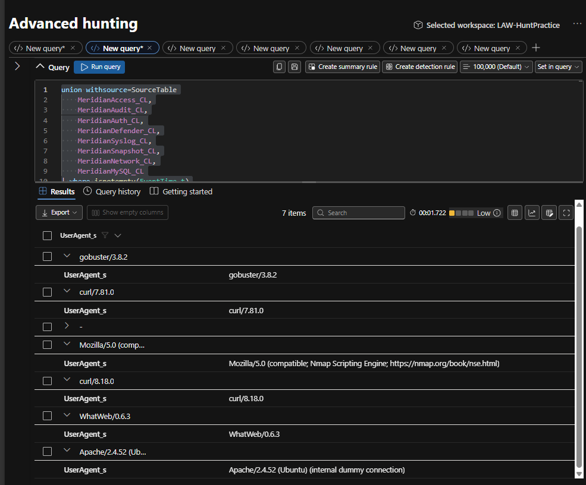

The results showed `gobuster/3.8.2`, `curl/7.81.0`, `curl/8.18.0`, the Nmap Scripting Engine user agent, and `WhatWeb/0.6.3`. The `Apache/2.4.52 (internal dummy connection)` entry is normal Apache behaviour, not the attacker.

<details>
<summary><b>Official solution: why this matters</b></summary>

Four tools in sequence: Nmap (03:47, HTTP enumeration scripts), curl (03:52, manual page probing), WhatWeb (03:54, technology fingerprinting), gobuster (03:55, directory brute-force with 18,454 requests). The progression shows methodical recon: port discovery, manual look, tech stack ID, then exhaustive directory enumeration.

Recognising the recon toolchain tells you the attacker's skill level and methodology. An attacker who runs WhatWeb between curl and gobuster is fingerprinting the tech stack to choose the right wordlist.

```kql
MeridianAccess_CL
| where isnotempty(EventTime_t)
| where ClientIp_s == "10.1.134.57"
| summarize FirstSeen=min(EventTime_t), Requests=count() by UserAgent_s
| order by FirstSeen asc
```

- **Pyramid of Pain:** Tools, identifying the attacker's recon toolkit
- **MITRE ATT&CK:** T1595, Active Scanning
</details>

---

## Section 2: Initial Access

*The deliberate pre-scan touch that turns out to be the way in, and what the LFI behind it pulled.*

### Q1: The Traversal Point

*Before the mass wordlist scanning starts, the attacker deliberately touches one endpoint on its own, the one that turns out to be their way in. Name it.*

**Answer:** `/config_viewer.php` ✅ 50/50

#### My approach

I compared the first-seen times of the unique requested URIs. Many of the initial requests occurred at exactly the same time, which indicated automated scanning activity. However, `/config_viewer.php` appeared separately several minutes later, making it stand out as a more deliberate request. I then searched for additional requests to the same endpoint and found later requests using the `file` parameter to access paths such as `../../../etc/passwd` and `database.conf`. This connected the earlier request to the later path-traversal/LFI activity and provided stronger evidence that this endpoint was used as part of the intrusion.

```kql
MeridianAccess_CL
| where isnotempty(EventTime_t)
| where ClientIp_s == "10.1.134.57"
| where EventTime_t between (
    datetime(2026-02-06 02:42:00) ..
    datetime(2026-02-06 05:30:00)
)
| where UserAgent_s !contains "gobuster"
| project EventTime_t, RequestUri_s, SourceFile_s, HttpMethod_s, StatusCode_s
| summarize FirstSeen=min(EventTime_t) by RequestUri_s
| order by FirstSeen asc
```

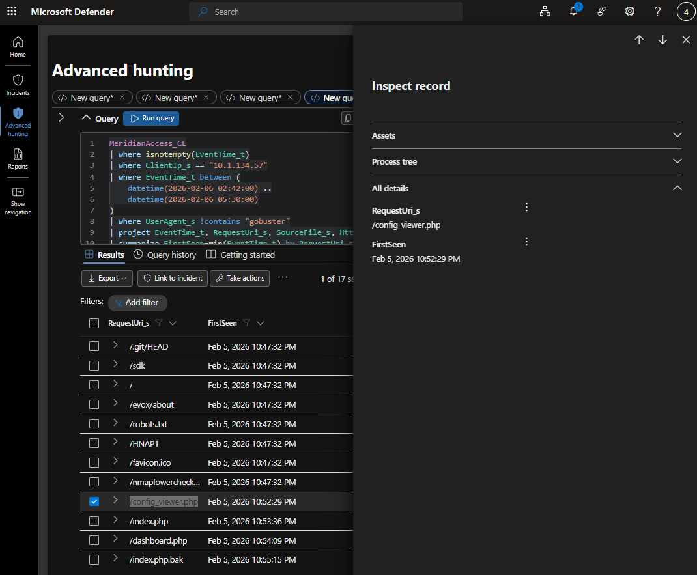

<details>
<summary><b>Official solution: why this matters</b></summary>

`config_viewer.php`, requested directly at 03:52:29, before the gobuster wordlist scan starts at 03:55:05. The attacker already knew this endpoint existed.

A deliberate, pre-scan request to a specific vulnerable endpoint indicates prior reconnaissance or leaked intelligence about the application.

```kql
MeridianAccess_CL
| where ClientIp_s == "10.1.134.57"
| where EventTime_t < datetime(2026-02-06 03:55:00)
| where RequestUri_s has "config"
| project EventTime_t, RequestUri_s, StatusCode_s, UserAgent_s
```

- **Pyramid of Pain:** Tools, the deliberate request versus automated scan pattern reveals operator behaviour
- **MITRE ATT&CK:** T1190, Exploit Public-Facing Application
</details>

### Q2: What They Pulled

*Once they're authenticated, that endpoint has a file parameter that isn't scoped to what it should be. They pull two files through it, in order. Name both, in the order they were read.*

**Answer:** `etc/passwd, database.conf` ✅ 100/100

#### My approach

I stayed in `MeridianAccess_CL` because I was still investigating web requests made by the attacker. I filtered on the attacker's IP address, `10.1.134.57`, and then narrowed the results to successful requests. The results showed two successful file requests through `config_viewer.php`. The first was `../../../etc/passwd`, followed about 35 seconds later by `database.conf`. Looking at `EventTime_t` confirmed the order in which the files were accessed. The sequence also made sense from an attacker's perspective: `/etc/passwd` could be used to identify valid system users, while `database.conf` could contain database connection information or credentials.

```kql
MeridianAccess_CL
| where isnotempty(EventTime_t)
| where ClientIp_s == "10.1.134.57"
| where EventTime_t between (
    datetime(2026-02-06 02:55:00) ..
    datetime(2026-02-06 05:30:00)
)
| where tostring(StatusCode_s) contains "2"
| project EventTime_t, RequestUri_s, SourceFile_s, HttpMethod_s, StatusCode_s
```

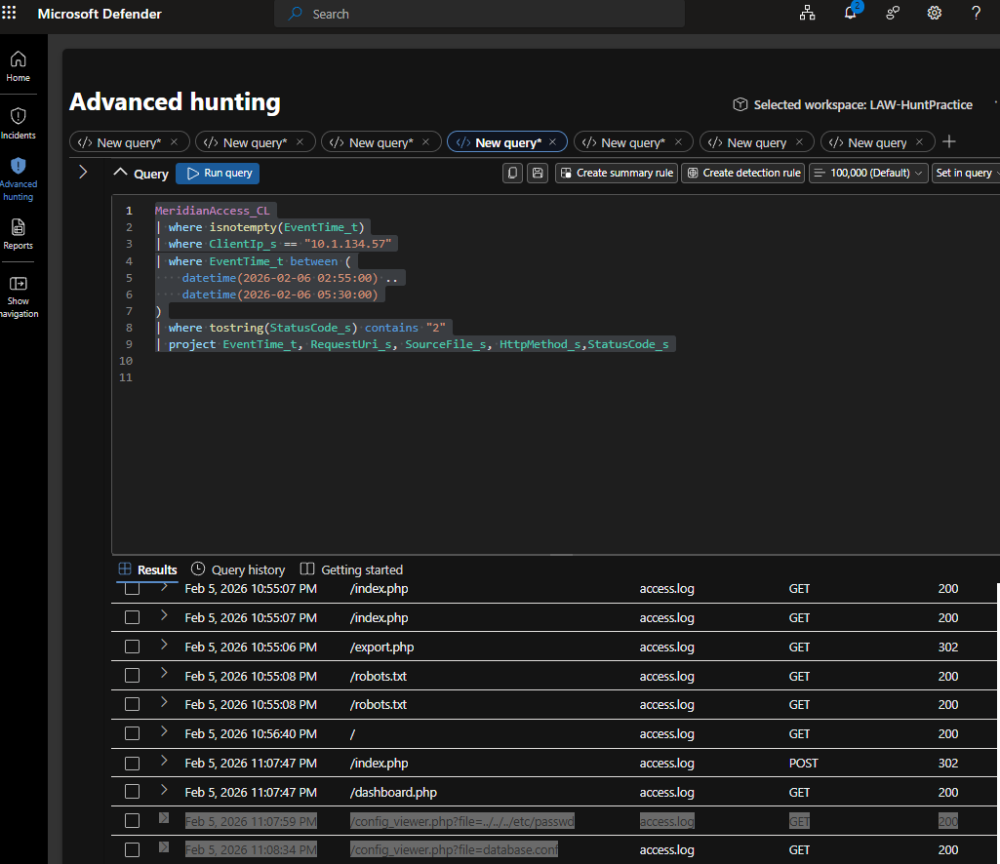

<details>
<summary><b>Official solution: why this matters</b></summary>

`/etc/passwd` first (04:07:59, 3077 bytes), then `database.conf` (04:08:34, 1231 bytes). Classic LFI two-step: enumerate users, then grab connection credentials.

The 35-second gap between the two reads shows deliberate, sequential exploitation, not automated scanning. The passwd file gives valid usernames; `database.conf` gives reusable credentials.

```kql
MeridianAccess_CL
| where ClientIp_s == "10.1.134.57"
| where RequestUri_s has "config_viewer" and RequestUri_s has "file="
| where StatusCode_s == "200"
| project EventTime_t, RequestUri_s, ResponseSize_s
```

- **Pyramid of Pain:** TTPs, authenticated LFI with deliberate file targeting
- **MITRE ATT&CK:** T1552.001, Credentials In Files
</details>

---

## Section 3: Borrowed Access (Credential Access)

### Q1: SSH Login with Stolen Credentials

**Finding:** `svc_backup` logged in over SSH from `10.1.134.57` at 04:09:31

#### My approach

I chose `MeridianAuth_CL` because this part of the investigation was about an SSH login, and authentication events are the best place to look for successful or failed logins. I filtered the results to the attack time window, then narrowed them to the `sshd` process because `sshd` is the Linux service that handles SSH connections. I also filtered on the attacker's source IP, `10.1.134.57`, so I was only looking at SSH activity coming from the attacker and not normal users.

Then I projected `EventTime_t`, `ProcessName_s`, `RawMessage_s`, `SourceIP`, and `SourcePort_s` so I could read the actual authentication message. In the results, the important line was:

```
Accepted password for svc_backup from 10.1.134.57 port 39206 ssh2
```

That told me three important things at once: the SSH login was successful, it came from the attacker's IP address, and the account used was `svc_backup`. The timestamp showed this happened at 04:09:31, only 57 seconds after `database.conf` had been read, which strongly connects the stolen configuration credentials to the successful SSH login.

```kql
MeridianAuth_CL
| where EventTime_t between (
    datetime(2026-02-06 02:55:00) ..
    datetime(2026-02-06 05:30:00)
)
| where ProcessName_s contains "sshd"
| where SourceIP == "10.1.134.57"
| project EventTime_t, ProcessName_s, RawMessage_s, SourceIP, SourcePort_s
```

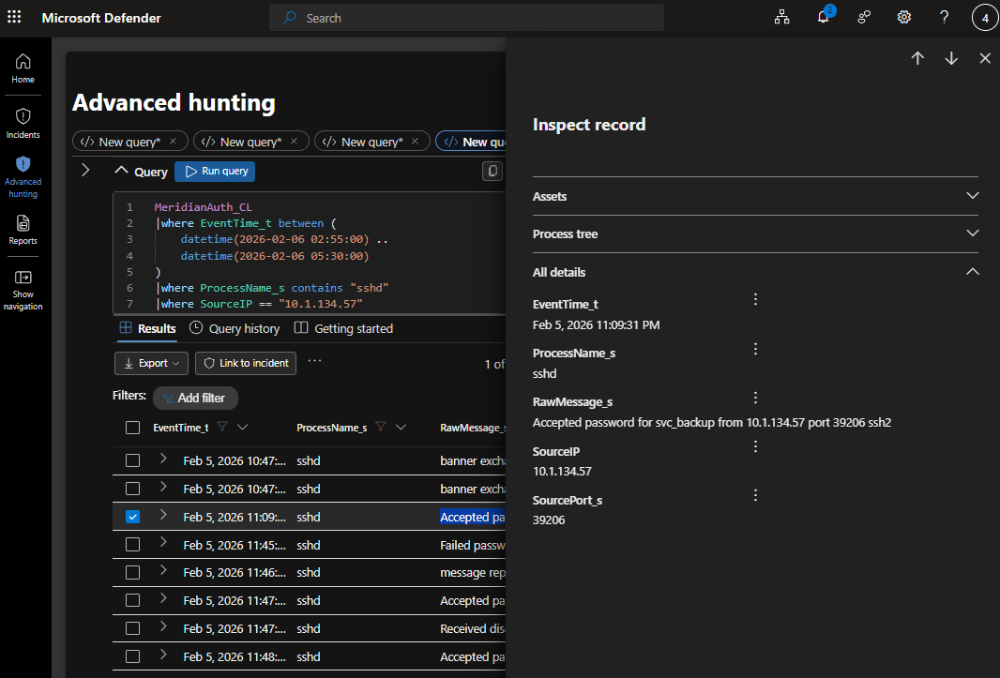

### Q2: Failed Privilege Escalation Attempts

#### My approach

I found the two failed privilege-escalation attempts by reviewing authentication and defence logs around the attacker's activity. First, I identified a `sudo` event showing `svc_backup : command not allowed` while attempting to run as `USER=root`, which confirmed that the compromised service account did not have sudo privileges. I then reviewed SSH authentication events and found several `Failed password for root` messages, including attempts from the attacker IP `10.1.134.57`. These showed that the attacker also tried to log in directly as root over SSH, but root password authentication did not succeed. The timeline showed that the sudo attempt happened before the attacker used the SUID shell, while the failed root SSH attempts happened afterward, likely as an attempt to obtain a cleaner root session.

```kql
MeridianDefender_CL
| where isnotempty(EventTime_t)
| where SourceIP == "10.1.134.57"
| where EventTime_t between (
    datetime(2026-02-06 02:42:00) ..
    datetime(2026-02-06 05:30:00)
)
| where EventCategory_s in ("Auth", "SSH", "Failed")
| order by EventTime_t asc
```

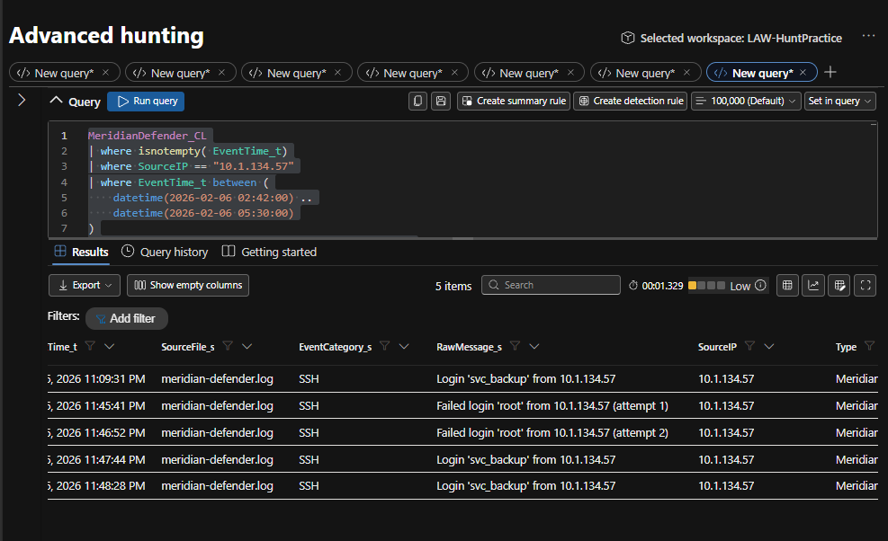

---

## Section 4: The Planted Root Shell (Privilege Escalation)

**Q1: The Planted Root Shell** — *svc_backup checks its own sudo rights first and gets nothing. Half an hour later they're root anyway, through a binary that was already sitting on disk waiting for them. Give me the full path and the flag it was run with.*

**Answer:** `/tmp/rootbash -p` ✅ 100/100

#### My approach

The attacker used the `svc_backup` account to execute a pre-staged SUID Bash binary located at `/tmp/rootbash`. The binary was launched with the `-p` flag, which tells Bash to preserve its effective privileged user ID instead of dropping those privileges. Audit log evidence showed that although the activity originated from `svc_backup`, the process ran with an effective UID of `0`, confirming that the attacker obtained root-level access. This was important because the same account had previously failed to gain elevated access through sudo, showing that the attacker switched to another privilege escalation method. The activity represents a successful privilege escalation using a SUID-enabled shell and maps to MITRE ATT&CK T1548.001 – Setuid and Setgid.

```kql
union withsource=SourceTable
    MeridianDefender_CL,
    MeridianAudit_CL,
    MeridianSyslog_CL
| where isnotempty(EventTime_t)
| where EventTime_t between (
    datetime(2026-02-06 04:39:30) ..
    datetime(2026-02-06 04:41:00)
)
| extend RawEvent = tostring(pack_all())
| project EventTime_t, SourceTable, RawEvent
| order by EventTime_t asc
```

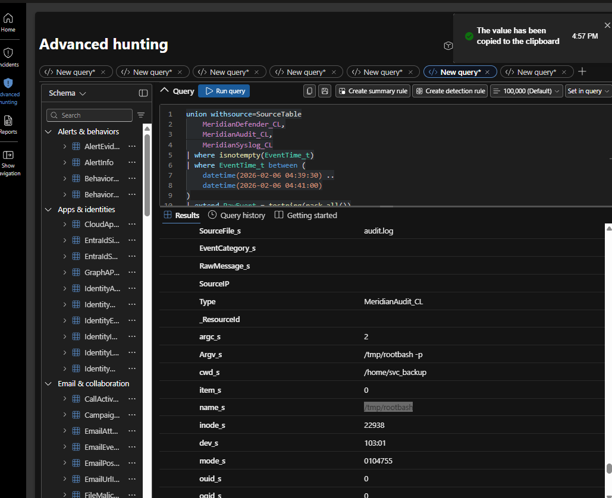

The audit record shows `Argv_s = /tmp/rootbash -p`, `cwd_s = /home/svc_backup`, `mode_s = 0104755` (the leading `4` is the SUID bit), and `ouid_s = 0` (file owned by root).

<details>
<summary><b>Official solution: why this matters</b></summary>

`/tmp/rootbash -p`, executed at 04:40:15 by `svc_backup` (auid) with euid=0. The `-p` flag preserves SUID privileges on a bash copy, the standard invocation for a pre-staged SUID backdoor.

This is the privilege escalation pivot. How the binary got onto disk isn't captured, but the execution record proves a SUID root shell was used.

```kql
MeridianAudit_CL
| where Types_s has "EXECVE"
| where Argv_s has "rootbash"
| project EventTime_t, comm_s, exe_s, Argv_s, auid_s, euid_s
```

- **Pyramid of Pain:** TTPs, SUID shell exploitation, a well-known privilege escalation technique
- **MITRE ATT&CK:** T1548.001, Setuid and Setgid
</details>

---

## Section 5: Persistence

*The /tmp shell is loud. They plant something better, and it survives every automated sweep.*

### Q1: The Second Foothold

*The /tmp shell is loud and sits somewhere obviously wrong. They plant something better a few minutes later: same trick, a much more convincing location. Give me the full path.*

**Answer:** `/opt/meridian/scripts/health_check` ✅ 100/100

#### My approach

I used the `MeridianSnapshot_CL` process snapshot data to identify a second, stealthier foothold created by the attacker. I filtered for processes with an executable link and found `health_check` running from `/opt/meridian/scripts/health_check`, a location that appeared legitimate because it was inside the application's normal scripts directory. The process snapshot showed a real UID of `1001`, associated with `svc_backup`, but an effective UID of `0`, confirming that the process was running with root privileges. I also observed a parent PID of `1`, indicating the process had become orphaned and was adopted by the system init process. This showed that the attacker had moved from the obvious `/tmp/rootbash` backdoor to a more convincing and persistent foothold, matching MITRE ATT&CK T1036.005 – Match Legitimate Name or Location.

```kql
MeridianSnapshot_CL
| where EventTime_t between (
    datetime(2026-02-06 04:40:00) ..
    datetime(2026-02-06 05:30:00)
)
| where isnotempty(ProcBeaconExeLink_s)
| project ProcBeaconName_s, ProcBeaconExeLink_s, ProcBeaconUid_s, ProcBeaconPPid_s
```

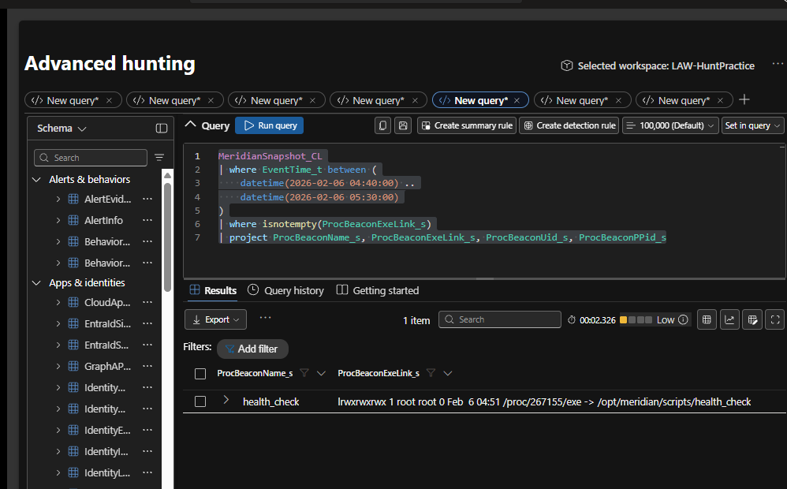

<details>
<summary><b>Official solution: why this matters</b></summary>

`/opt/meridian/scripts/health_check`, real UID 1001 (`svc_backup`), effective UID 0, PPid 1 (orphaned). Hidden in the app's own scripts folder with a name that reads as routine maintenance.

This is the durable persistence mechanism. Unlike `/tmp/rootbash`, this location blends into the legitimate application structure and survives the automated sweep.

```kql
MeridianSnapshot_CL
| where isnotempty(ProcBeaconExeLink_s)
| project ProcBeaconName_s, ProcBeaconExeLink_s, ProcBeaconUid_s, ProcBeaconPPid_s
```

- **Pyramid of Pain:** TTPs, masquerading in a legitimate application directory
- **MITRE ATT&CK:** T1036.005, Match Legitimate Name or Location
</details>

### Q2: Why It Survived

*The automated defence caught the /tmp shell in its next sweep and killed it. It caught this second one too, flagged it as non-baseline, in the log, in plain sight. It's still running. Explain what category of thing the sweep actually cleans up automatically, and why this doesn't fall into any of them.*

**Answer:** The sweep only auto-remediates specific known categories like SUID files in /tmp, SSH keys, cron jobs, and protected config changes; `/opt/meridian/scripts/health_check` was only flagged as a non-baseline application file, so no automatic cleanup rule applied to it. ✅ 150/150

#### My analysis

The automated defence sweep detected both the original `/tmp/rootbash` backdoor and the later `/opt/meridian/scripts/health_check` foothold, but detection did not mean every finding would be removed automatically. The sweep was designed with specific remediation rules for certain categories of malicious or unauthorized changes, such as suspicious SUID binaries in temporary locations, unauthorized SSH keys, cron-based persistence, and changes to protected configuration files.

Because `/tmp/rootbash` matched one of those cleanup conditions, the sweep identified it as a dangerous SUID shell in an obviously suspicious location and removed it automatically. The second foothold was different: `health_check` was placed inside the legitimate Meridian application directory and appeared to be a normal maintenance utility. The defence tool still noticed that the file was not part of the expected baseline and logged it as non-baseline, but the file did not match any of the categories the remediation logic was programmed to delete. As a result, the tool generated an alert but took no cleanup action, allowing the malicious process to remain active.

This demonstrates an important security principle: a defensive tool can have strong detection capabilities while still having gaps in automated response, because remediation is usually limited to predefined scenarios to avoid deleting legitimate files or disrupting applications. The attacker benefited from that gap by placing the backdoor in a trusted-looking location where it would be detected as unusual but would not trigger any automatic removal rule.

<details>
<summary><b>Official solution: why this matters</b></summary>

The sweep only remediates SSH keys, crontabs, temp directories, SUID files in watched paths, and systemd services. `health_check` is a plain script under an application directory, none of those five categories. Detected but never acted on.

This is the critical detection-remediation gap. The automated tooling flagged it as non-baseline in every sweep but had no remediation rule for scripts in application directories.

```kql
MeridianDefender_CL
| where EventCategory_s == "SWEEP"
| where RawMessage_s has "health_check"
| project EventTime_t, RawMessage_s
```

- **Pyramid of Pain:** TTPs, exploiting the gap between detection coverage and remediation capability
- **MITRE ATT&CK:** T1564.001, Hidden Files and Directories
</details>

---

## Section 6: Calling Home (Command and Control)

*The second backdoor doesn't sit idle, it keeps trying to reach out.*

### Q1: Calling Home

*Give me the destination it kept hitting, and tell me whether that block alone actually neutralised it.*

**Answer:** `10.1.134.57:43212, not neutralised` ✅ 125/125

#### My approach

I reviewed the Defender network telemetry and identified repeated outbound communication attempts from the compromised host `10.1.15.67` to `10.1.134.57` on port `43212`. The event message showed that this traffic was blocked, confirming that the defensive control stopped the connection at the network or firewall level. However, blocking the connection did not mean the malicious `health_check` process itself had been terminated. The process was still present and capable of continuing to run, which meant it could keep attempting to reconnect or perform other malicious actions locally. This is an important distinction in incident response: network containment only limits communication, while process-level remediation actually stops the malicious program.

```kql
MeridianDefender_CL
| where EventTime_t between (
    datetime(2026-02-06 04:45:00) ..
    datetime(2026-02-06 06:00:00)
)
| where isnotempty(DestIp_s) or isnotempty(DestPort_s)
| project EventTime_t, EventCategory_s, SourceIP, DestIp_s, DestPort_s, RawMessage_s
| order by EventTime_t asc
```

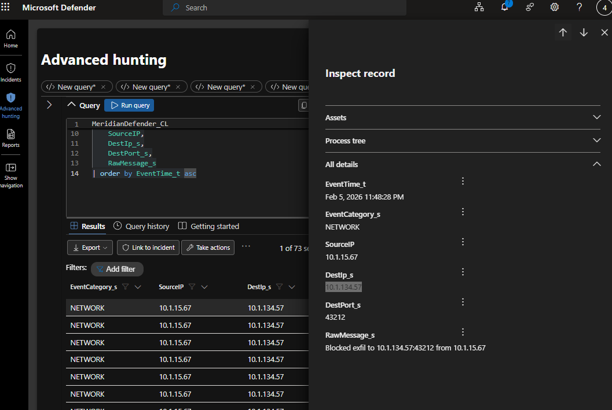

<details>
<summary><b>Official solution: why this matters</b></summary>

`10.1.134.57:43212`, 73 blocked connection attempts between 04:48 and 05:02, classic beacon-on-a-schedule with backoff. The network block stopped the callback but never killed the process itself.

Blocking network traffic is not neutralisation. The process is still running, still trying, and will succeed if the block is ever lifted.

```kql
MeridianDefender_CL
| where EventCategory_s == "NETWORK"
| where DestIp_s == "10.1.134.57"
| summarize count() by DestPort_s
| project DestPort_s, count_
```

- **Pyramid of Pain:** Network Artifacts, C2 destination address and port
- **MITRE ATT&CK:** T1071, Application Layer Protocol
</details>

### Q2: What the Block Proves

*The network block stopped 73 outbound connections to the C2 destination. State what this evidence proves about the threat, and what it does not prove.*

**Answer:** Proves the backdoor was actively attempting repeated outbound communication with the C2 server and that the firewall successfully blocked those connections; does not prove the malicious process was terminated, removed, or fully neutralised. ✅ 75/75

#### My analysis

The 73 blocked outbound connections prove that the malicious `health_check` process was still active and repeatedly trying to communicate with its command-and-control destination at `10.1.134.57:43212`. Because the same destination was contacted many times, this was not a single accidental connection attempt; it showed persistent beaconing behaviour, which is typical of malware or a backdoor trying to maintain communication with an attacker-controlled system.

The firewall blocked those connections, so the threat was contained at the network level during those attempts. However, this evidence does not prove that the malicious process itself was stopped, deleted, or removed from the host. A firewall can prevent traffic while leaving the malware running in memory or on disk, meaning the process may keep retrying, switch to another destination, or perform other local actions. The block proves outbound C2 was attempted and prevented, but not that the system was fully remediated.

<details>
<summary><b>Official solution: why this matters</b></summary>

The network block proves outbound TCP connections to `10.1.134.57:43212` were intercepted and dropped (73 times). The attacker's C2 channel is severed at the network layer.

It does NOT prove the backdoor process is stopped, the attacker's code is removed, or the host is contained. The backdoor process (PID 267155) is still running at 05:30 and will resume C2 communication the moment the block is lifted.

This is the most common analyst over-claim in network defence. A firewall rule that blocks traffic is not the same as killing the process that generates it. The threat persists until the process is terminated and the binary removed.

```kql
MeridianSnapshot_CL
| where isnotempty(EventTime_t)
| project EventTime_t, ProcBeaconExeLink_s, ProcBeaconPid_s
```

- **Pyramid of Pain:** Network Artifacts, distinguishing network-layer blocking from host-layer containment
- **MITRE ATT&CK:** T1071, Application Layer Protocol
</details>

---

## Section 7: Collection

*What left the database, and one more thing the final sweep catches beyond its usual routine.*

### Q1: What Left the Database

*Somewhere in this window the defence stack flags a full export off the application's own data. Given the estate, what kind of data are we talking about?*

**Answer:** `patient health records` ✅ 75/75

```kql
MeridianDefender_CL
| where EventTime_t between (
    datetime(2026-02-06 02:40:00) ..
    datetime(2026-02-06 07:30:00)
)
| where EventCategory_s == "WEB"
| where RawMessage_s has "export"
| project EventTime_t, RawMessage_s
```

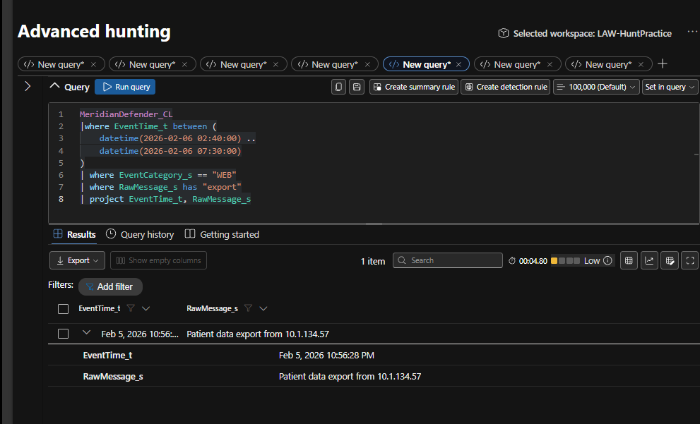

<details>
<summary><b>Official solution: why this matters</b></summary>

Patient data: "WEB: Patient data export from 10.1.134.57" in the defender log. This is a healthcare portal; the patients table is the highest-value target.

This confirms data exfiltration of PII/PHI from the application's primary dataset. A separate "DB: Full patient table query" entry at 02:58 is a red herring, 49 minutes before the first confirmed attacker activity.

```kql
MeridianDefender_CL
| where EventCategory_s == "WEB"
| where RawMessage_s has "export"
| project EventTime_t, RawMessage_s
```

- **Pyramid of Pain:** TTPs, targeted extraction of high-value healthcare records
- **MITRE ATT&CK:** T1213, Data from Information Repositories
</details>

### Q2: What the Final Sweep Caught

**Finding:** `backup.conf tampered -- reverting`

#### My approach

I reviewed the final automated sweep events in `MeridianDefender_CL` and looked specifically for evidence of configuration tampering. The query returned the message `backup.conf tampered -- reverting`, showing that the attacker or the malicious backdoor had modified the legitimate backup configuration file. Unlike the earlier `health_check` foothold, this change matched one of the sweep's built-in remediation rules, so the defensive tool automatically restored the configuration rather than only logging it.

Tampering with `backup.conf` was significant because the backup infrastructure is a trusted part of the environment, and modifying its configuration could be used to preserve access, alter backup behaviour, or abuse legitimate scheduled operations. The fact that the sweep reverted the change shows the defence stack could detect deviations from the expected configuration baseline and restore known-good settings. This maps to MITRE ATT&CK T1565.001 – Stored Data Manipulation, because the attacker modified stored configuration data in an attempt to influence how a legitimate system function operated.

```kql
MeridianDefender_CL
| where EventTime_t between (
    datetime(2026-02-06 02:40:00) ..
    datetime(2026-02-06 07:30:00)
)
| where RawMessage_s has "conf"
| project EventTime_t, RawMessage_s
```

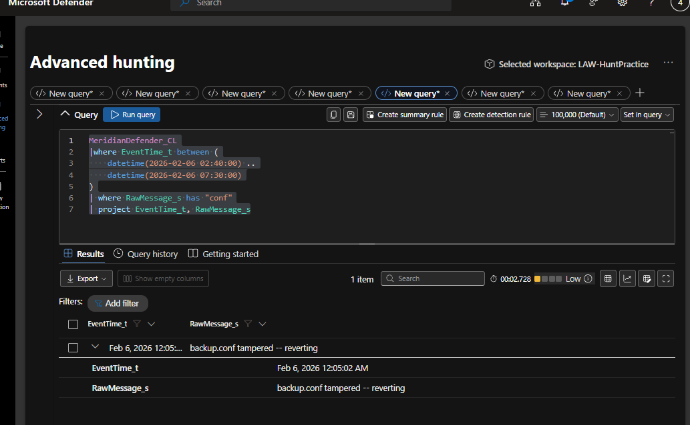

---

## Section 8: Defence Evasion and Detection Gaps

*Separating the defence stack's own bootstrap noise from real signal, and one case of real collateral damage to visibility.*

### Q1: Signal or Setup Noise

*Before any of the real intrusion, the defence log already fires a burst of detections: SSH key changes, crontab changes, a new systemd service, all auto-reverted within a second. Is that part of the intrusion, or something else? State which, and why.*

**Answer:** `false positive` ✅ 150/150

The burst happens more than 50 minutes before the first confirmed attacker activity, so it can't be the attacker. It's the defence stack's own installation being misread as tampering.

<details>
<summary><b>Official solution: why this matters</b></summary>

False positive / setup noise. The detection burst at 02:53:31 is the defence stack's own installation being misread as tampering, over 50 minutes before the first confirmed attacker activity at 03:47:26.

Treating installation artefacts as attack indicators is a common triage error. The detections are real events, but the context proves they're self-generated, not attacker-driven.

```kql
MeridianDefender_CL
| where EventCategory_s == "DETECTION"
| where EventTime_t < datetime(2026-02-06 03:00:00)
| project EventTime_t, RawMessage_s
```

- **Pyramid of Pain:** TTPs, distinguishing defence-stack bootstrap noise from genuine signal
- **MITRE ATT&CK:** T1036, Masquerading
</details>

### Q2: Collateral Damage

*The very first automated sweep, long before the real intrusion starts, removes a 'new systemd service' as part of its routine cleanup. It took out something that wasn't the attacker's. Name what it killed, and what that cost the investigation for the rest of the incident.*

**Answer:** `sysmon, process telemetry gaps` ✅ 150/150

#### My approach

During the very first automated defence sweep, the cleanup logic detected `sysmon.service` as a new or non-baseline systemd service and incorrectly treated it as suspicious persistence. The sweep then removed `sysmon.service`, even though Sysmon was part of the defensive monitoring stack and not something installed by the attacker. Because this happened roughly 40 minutes before the real intrusion began, the system lost Sysmon's process-level visibility for essentially the entire attack.

That meant investigators no longer had the richer telemetry Sysmon normally provides, such as process creation, executable paths, command-line arguments, parent-child process relationships, and other endpoint activity. Later attacker actions had to be reconstructed from other sources such as `audit.log`, syslog, Defender events, and process snapshots. This is why the removal counts as collateral damage: the defensive tool was trying to improve security, but its overly aggressive remediation weakened detection capability. It also explains the MITRE mapping to T1562.001 – Impair Defenses: Disable or Modify Tools, although here the impairment was caused accidentally by the environment's own automated response rather than directly by the attacker.

```kql
MeridianDefender_CL
| where EventTime_t between (
    datetime(2026-02-06 02:50:00) ..
    datetime(2026-02-06 03:10:00)
)
| where EventCategory_s == "SWEEP"
| where RawMessage_s has "Removed service"
| where EventTime_t < datetime(2026-02-06 03:10:00)
| project EventTime_t, RawMessage_s
```

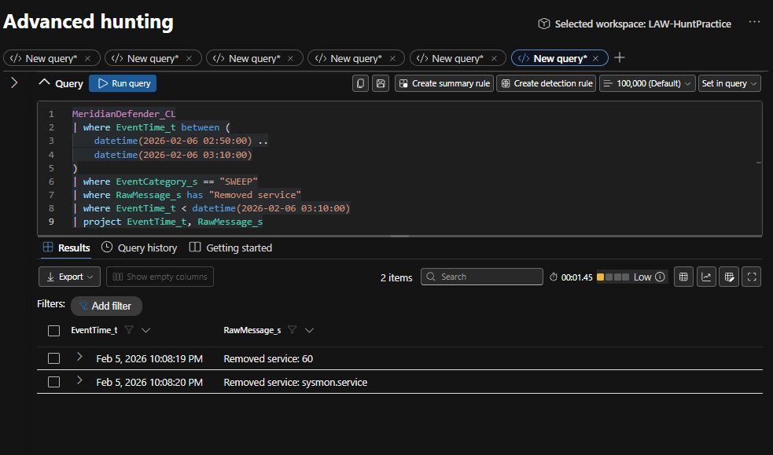

<details>
<summary><b>Official solution: why this matters</b></summary>

`sysmon.service` (Linux Sysmon), removed at 03:08:19 by the first automated sweep as a 'new/non-baseline systemd service', blinding process-level telemetry ~40 minutes before the real intrusion began.

The sweep's overzealous remediation created the biggest detection gap in the entire incident. Everything the attacker did after 03:08 has no process-level Sysmon coverage.

```kql
MeridianDefender_CL
| where EventCategory_s == "SWEEP"
| where RawMessage_s has "Removed service"
| where EventTime_t < datetime(2026-02-06 03:10:00)
| project EventTime_t, RawMessage_s
```

- **Pyramid of Pain:** TTPs, unintended defence impairment by the estate's own tooling
- **MITRE ATT&CK:** T1562.001, Impair Defenses: Disable or Modify Tools
</details>

---

## Section 9: Response

### Q1: Forensic Memory Capture

**Finding:** Admin ran AVML twice (05:27:48 and 05:28:24), writing memory to `/tmp/evidence/memory.lime`

#### My approach

I reviewed the `MeridianAudit_CL` logs for process execution events after the administrator regained access to the system. The evidence showed that the administrator ran AVML twice, at approximately 05:27:48 and 05:28:24, to capture the system's volatile memory. AVML is a Linux memory-acquisition tool used to create a forensic image of RAM while the machine is still running, which is important because memory can contain evidence that disappears after a reboot or process termination. The captured memory was written to `/tmp/evidence/memory.lime`, preserving the live state of the compromised host before remediation actions were taken.

This was a proper forensic response because the `health_check` backdoor was still active, so investigators needed to preserve running processes, network connections, credentials, and other volatile artefacts before disturbing the system. The activity was confirmed using `EXECVE` audit events and maps to MITRE ATT&CK T1005 – Data from Local System, because the administrator collected local system data for forensic analysis.

```kql
MeridianAudit_CL
| where Types_s has "EXECVE"
| where EventTime_t > datetime(2026-02-06 05:25:00)
| where Argv_s has "avml" or comm_s has "avml"
| project EventTime_t, Argv_s, exe_s
```

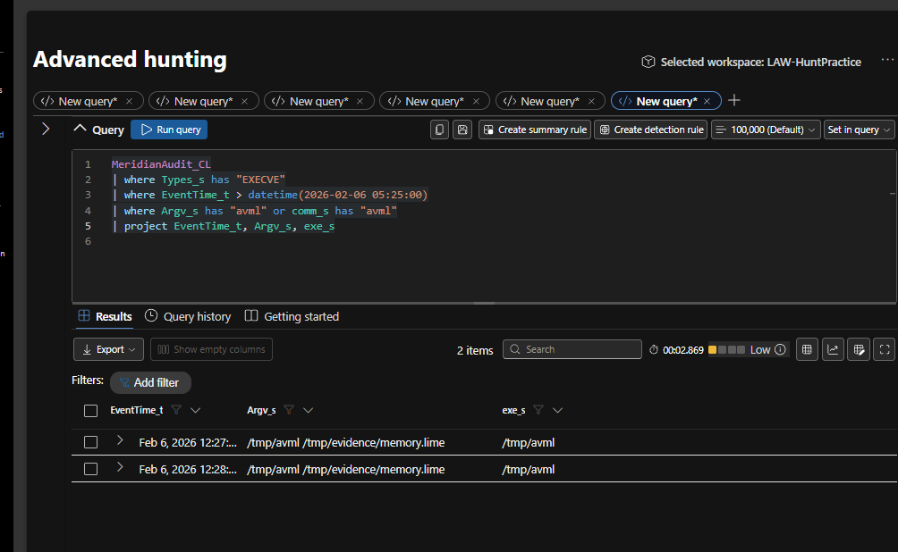

### Q2: What's Still Live

*Pull it together. The automated sweep ran its full cycle, the admin came back and did the responsible forensic thing, and this still isn't closed. What's the one concrete action IR still has to do manually before this incident can actually be called contained?*

**Answer:** `Kill /opt/meridian/scripts/health_check` ✅ 200/200 — hunt complete, on time. 🏅 **Badge earned: Seasoned Hunter**

<details>
<summary><b>Official solution: why this matters</b></summary>

Manually kill and remove `health_check`; it's the one artefact nothing has touched. The sweep killed rootbash, reverted `backup.conf`, the admin captured memory, but `health_check` was only ever flagged, never remediated.

This is the final synthesis. The incident isn't closed until someone manually handles the one thing that fell through every automated and manual response action.

```kql
MeridianDefender_CL
| where RawMessage_s has "health_check"
| project EventTime_t, EventCategory_s, RawMessage_s
```

- **Pyramid of Pain:** TTPs, persistence surviving both automated and manual response
- **MITRE ATT&CK:** T1036.005, Match Legitimate Name or Location
</details>

---

## Conclusion

The incident was not fully contained even after the automated sweep completed and the administrator returned to the system. The sweep removed `/tmp/rootbash`, reverted the tampered `backup.conf`, and blocked outbound C2 communication, while the administrator captured memory using AVML for forensic preservation. However, the second backdoor, `/opt/meridian/scripts/health_check`, was still running because it had only been detected and flagged as a non-baseline file, not automatically removed. This process had root-level privileges and kept attempting outbound communication. The final manual containment step is to kill and remove `/opt/meridian/scripts/health_check` before the incident can truly be considered contained.

### Key lessons

- **Detection is not remediation.** The sweep saw `health_check` every cycle and never acted on it.
- **A network block is not containment.** 73 blocked callbacks proved the backdoor was alive, not dead.
- **Context separates signal from noise.** The 02:53 detection burst was the defence stack installing itself, not the attacker.
- **Aggressive auto-remediation can blind you.** The sweep removed Sysmon before the attack even started.
- **Use event time, not ingestion time.** Every query here is anchored on `EventTime_t`.

---

## IOCs

| Type | Indicator | Context |
|---|---|---|
| IP | `10.1.134.57` | Attacker source and C2 server |
| IP:Port | `10.1.134.57:43212` | C2 callback destination (73 blocked attempts) |
| URI | `/config_viewer.php?file=` | LFI / path traversal entry point |
| File | `/tmp/rootbash` | SUID root shell (removed by sweep) |
| File | `/opt/meridian/scripts/health_check` | Persistent root backdoor (still running) |
| Account | `svc_backup` (UID 1001) | Compromised service account |
| File | `backup.conf` | Tampered, reverted by sweep |
| User agents | `gobuster/3.8.2`, `curl/7.81.0`, `curl/8.18.0`, Nmap Scripting Engine, `WhatWeb/0.6.3` | Recon toolkit |

---

## MITRE ATT&CK Mapping

| Tactic | Technique | ID |
|---|---|---|
| Reconnaissance | Active Scanning | T1595 |
| Initial Access | Exploit Public-Facing Application | T1190 |
| Credential Access | Credentials In Files | T1552.001 |
| Privilege Escalation | Setuid and Setgid | T1548.001 |
| Defense Evasion / Persistence | Match Legitimate Name or Location | T1036.005 |
| Defense Evasion | Hidden Files and Directories | T1564.001 |
| Command and Control | Application Layer Protocol | T1071 |
| Collection | Data from Information Repositories | T1213 |
| Impact | Stored Data Manipulation | T1565.001 |
| Defense Evasion | Masquerading | T1036 |
| Defense Evasion | Impair Defenses: Disable or Modify Tools | T1562.001 |
| Collection (IR activity) | Data from Local System | T1005 |
